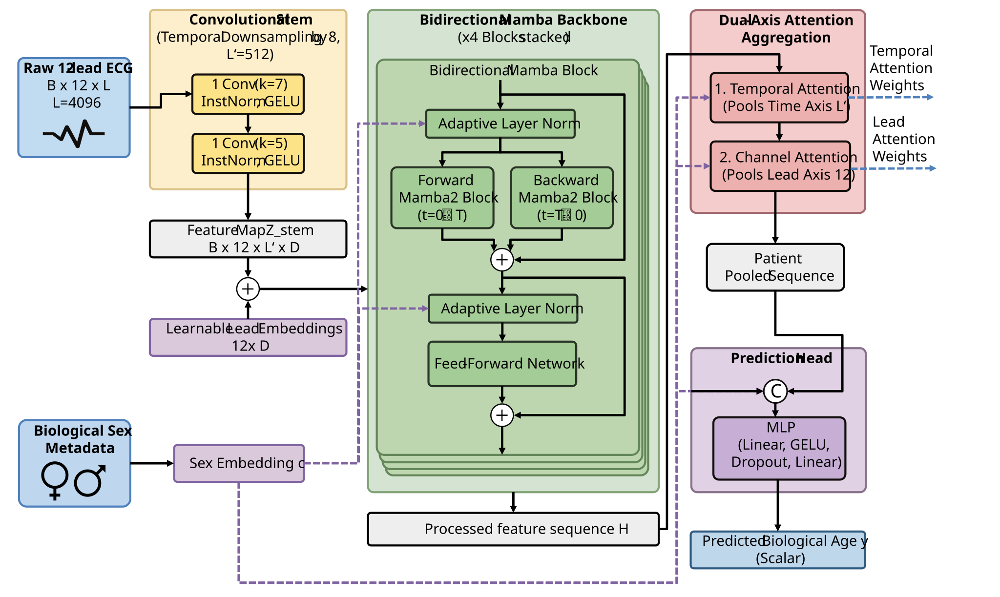

# Demographic-Conditioned State Space Models for ECG-Based Age Estimation

Official implementation of **"Demographic-Conditioned State Space Models for ECG-Based Age Estimation"**, accepted at MICCAI 2026.

> Benjamin Bracke<sup>1,2</sup>, Andreas Stang<sup>2</sup>, Börge Schmidt<sup>2</sup>, Christoph M. Friedrich<sup>1,2</sup>
>
> <sup>1</sup> Department of Computer Science, University of Applied Sciences and Arts Dortmund, 44227 Dortmund, Germany
>
> <sup>2</sup> Institute for Medical Informatics, Biometry and Epidemiology, University Hospital Essen, 45130 Essen, Germany

## Overview

We propose a bidirectional State Space Model (Mamba2) architecture with demographic conditioning for ECG-based biological age estimation. The model processes 12-lead ECG signals through:

1. **Per-lead convolutional stem** with instance normalization
2. **Bidirectional Mamba2 backbone** with Adaptive Layer Normalization (AdaLN) for demographic conditioning (sex)
3. **Hierarchical attention pooling** (temporal → lead-level) to produce a patient-level representation
4. **Regression head** predicting biological age

Training incorporates multiple regularization strategies including stochastic depth, MixStyle, channel dropout, time masking, and EMA weight averaging.

<p align="center">
  
</p>
<p align="center"><em>Overview of the proposed demographic-conditioned bidirectional Mamba2 architecture.</em></p>

## Repository Structure

```
repo/
├── preprocessing/
│   ├── generate_h5.py           # HDF5 generation from raw WFDB files
│   └── train_test_split.py      # Patient-level age-stratified train/test split
├── survival_analysis/
│   ├── run_validation.sh        # Sequentially runs survival analysis scripts on test set
│   ├── calibrate_predictions.py # Calibrates predictions on subset of test set (optional)
│   ├── prepare_data.py          # Prepares data for survival analysis
│   ├── plot_performance.py      # Plots age gap related performance metrics
│   └── survival_analysis.py     # Survival analysis using Cox proportional hazards model
├── model.py           # Model architecture (BiMamba2, AdaLN, attention pooling)
├── train.py           # Training script with mixed precision, gradient accumulation
├── inference.py       # Inference script for evaluation on held-out datasets
├── dataloader.py      # Memory-efficient lazy HDF5 dataset
├── augmentations.py   # ECG-specific data augmentations
├── metrics.py         # Regression evaluation metrics
├── requirements.txt   # Python dependencies
└── README.md
```

## Requirements

- Python ≥ 3.10
- CUDA-compatible GPU (BFloat16 support recommended, e.g., NVIDIA A100 / RTX 30xx+)

Install dependencies:

```bash
pip install -r requirements.txt
```

## Data Preparation

### Expected Format

The training pipeline expects:

1. **HDF5 file** containing ECG traces with shape `[N, seq_len, 12]` (e.g., `[N, 4096, 12]` for 10-second recordings at 400 Hz).
2. **CSV file** containing patient metadata with at minimum:
   - `id_exam` (or custom ID column): Exam identifier matching HDF5 order
   - `age`: Patient age in years
   - `sex` (optional): `"F"` / `"M"` or `"female"` / `"male"`

### ECG Preprocessing

Raw ECG recordings in WFDB format are converted to HDF5 using the [`ecg-preprocessing`](https://github.com/antonior92/ecg-preprocessing) toolkit by Ribeiro et al. Install it as follows:

```bash
git clone https://github.com/antonior92/ecg-preprocessing.git
cd ecg-preprocessing
pip install -r requirements.txt
python setup.py install
```

Then generate the HDF5 file using `generate_h5.py` with the following parameters:

```bash
python generate_h5.py RECORDS.txt output.h5 \
    --root_dir /path/to/wfdb/files/ \
    --new_freq 400 \
    --new_len 4096 \
    --scale 2 \
    --use_all_leads
```

| Parameter | Value | Description |
|---|---|---|
| `--new_freq` | 400 | Resample all recordings to 400 Hz |
| `--new_len` | 4096 | Pad or truncate to 4096 samples (~10.24 s at 400 Hz) |
| `--scale` | 2 | Amplitude scaling factor |
| `--use_all_leads` | — | Include all 12 leads (derive missing leads if needed) |

No baseline or powerline removal is applied at the preprocessing stage — the model performs per-lead instance normalization internally.

See `preprocessing/` for dataset-specific preprocessing and splitting scripts.

### Train/Test Split

The `preprocessing/train_test_split.py` script provides a patient-level, age-stratified split:

- Splitting is performed at the **patient level** (not per exam) to prevent data leakage
- Age is used for stratified sampling to preserve the age distribution across splits
- Patients with ages outside the range [16, 85] are assigned to the training set only

## Training

```bash
python train.py /path/to/traces.hdf5 /path/to/metadata.csv \
    --folder output/ \
    --epochs 50 \
    --batch_size 256 \
    --accum_iter 4 \
    --lr 5e-3 \
    --hidden_dim 128 \
    --layers 4 \
    --downsample 8 \
    --gpu 0
```

### Key Arguments

| Argument | Default | Description |
|---|---|---|
| `--epochs` | 50 | Number of training epochs |
| `--batch_size` | 256 | Batch size per GPU |
| `--accum_iter` | 4 | Gradient accumulation steps (effective batch = batch_size × accum_iter) |
| `--lr` | 1e-3 | Peak learning rate (with cosine decay) |
| `--hidden_dim` | 128 | Model hidden dimensionality |
| `--layers` | 4 | Number of BiMamba2 blocks |
| `--downsample` | 8 | Temporal downsampling factor in convolutional stem |
| `--resume` | — | Resume training from latest checkpoint |
| `--gpu` | None | GPU device ID |

### Outputs

Training produces the following in the output folder:
- `best.pth` — Checkpoint with lowest validation loss
- `model.pth` — Latest checkpoint
- `history.csv` — Per-epoch training and validation metrics
- `args.json` — Saved training configuration

## Inference

```bash
python inference.py /path/to/traces.hdf5 /path/to/metadata.csv \
    --folder output/ \
    --batch_size 64 \
    --gpu 0
```

### Outputs

- `inference_history.csv` — Aggregate evaluation metrics
- `inference_predictions.csv` — Per-sample predicted and target ages


## Regression Evaluation & Survival Analysis

We evaluate model performance through both standard regression metrics and survival analysis (assessing the association of predicted age gaps with all-cause mortality). 

The evaluation pipeline includes post-hoc calibration (optional), exam-to-patient aggregation, visual plotting, and Cox proportional hazards regression. To run the full validation pipeline, use the provided wrapper script:

```bash
./survival_analysis/run_validation.sh /path/to/predictions.csv /path/to/output_dir/ [calibration_samples] [bias_only] [age_threshold]
```

### Pipeline Arguments

| Argument | Default | Description |
|---|---|---|
| `/path/to/predictions.csv` | *(Required)* | CSV file containing inference predictions (output of `inference.py`) |
| `/path/to/output_dir/` | *(Required)* | Directory where output files, plots, and survival summaries will be saved |
| `[calibration_samples]` | `0` | Number of random validation samples used for calibration (set to `0` to skip, as in the official submission) |
| `[bias_only]` | `false` | If `true`, applies only a constant shift for calibration instead of a linear mapping |
| `[age_threshold]` | `8` | Discrepancy threshold in years to categorize patients into overestimation and underestimation groups |


## Results

Comparison of the proposed State Space Model (BiMamba2) variants (sex-conditioned and sex-agnostic) against the [1D-ResNet Baseline](https://github.com/antonior92/ecg-age-prediction). 

Pretrained models and prediction outputs from the MICCAI 2026 submission are available on Hugging Face:
🤗 [https://huggingface.co/BBracke/demographic-ssm-ecg-age](https://huggingface.co/bbracke/demographic-ssm-ecg-age)

### Quantitative Regression Results

Regression performance evaluated on the **CODE-15%** and **SaMi-Trop** datasets. Metrics include Mean Absolute Error (MAE) ± standard deviation (STD), Pearson correlation ($R$), coefficient of determination ($R^2$), and mean predicted ages.

| Dataset / Metric | 1D-ResNet Baseline | Proposed Model<br>(sex-conditioned) | Proposed Model<br>(sex-agnostic) |
|---|:---:|:---:|:---:|
| **CODE-15% Dataset**<sup>1</sup> | | | |
| &emsp; MAE ± STD | 8.44 ± 7.12 | **6.72 ± 5.81** | 6.87 ± 5.88 |
| &emsp; $R$ ; $R^2$ | 0.84 ; 0.69 | **0.90 ; 0.80** | 0.89 ; 0.79 |
| &emsp; Pred. Mean ± STD | 52.1 ± 18.7 | **51.6** ± 18.3 | 52.2 ± **18.1** |
| **SaMi-Trop Dataset**<sup>2</sup> | | | |
| &emsp; MAE ± STD | 9.96 ± 7.61 | **7.83 ± 6.30** | 8.06 ± 6.31 |
| &emsp; $R$ ; $R^2$ | 0.60 ; 0.04 | **0.70 ; 0.38** | 0.69 ; 0.35 |
| &emsp; Pred. Mean ± STD | 62.6 ± 14.1 | **62.0** ± 12.3 | 62.7 ± **12.0** |

<sup>1</sup> Real Mean ± STD for CODE-15%: 51 ± 20.  
<sup>2</sup> Real Mean ± STD for SaMi-Trop: 60 ± 13.

### Prognostic Value (Cox Regression for All-Cause Mortality)

Age- and sex-adjusted Cox proportional hazards regression. Hazard Ratios (HR) compare the **Overestimation** (ECG-age > chronological age + 8 years) and **Underestimation** (ECG-age < chronological age - 8 years) groups against the Concordant baseline (ECG-age discrepancy ≤ 8 years).

| Model / Age-Gap Group | CODE-15% HR (95% CI) | CODE-15% p-value | SaMi-Trop HR (95% CI) | SaMi-Trop p-value |
|---|:---:|:---:|:---:|:---:|
| **1D-ResNet Baseline** | | | | |
| &emsp; Underestimation | 0.81 (0.76–0.86) | < 0.005 | 0.95 (0.55–1.64) | 0.86 |
| &emsp; Overestimation | 1.80 (1.68–1.92) | < 0.005 | 2.38 (1.51–3.74) | < 0.005 |
| **Proposed Model (sex-conditioned)** | | | | |
| &emsp; Underestimation | 0.78 (0.73–0.83) | < 0.005 | 0.86 (0.49–1.50) | 0.59 |
| &emsp; Overestimation | 2.06 (1.92–2.21) | < 0.005 | 1.76 (1.10–2.80) | 0.02 |
| **Proposed Model (sex-agnostic)** | | | | |
| &emsp; Underestimation | 0.79 (0.74–0.84) | < 0.005 | 0.67 (0.36–1.23) | 0.19 |
| &emsp; Overestimation | 1.99 (1.85–2.13) | < 0.005 | 1.32 (0.81–2.13) | 0.26 |

## Pretrained Weights

Pretrained model weights are available on HuggingFace:

🤗 [https://huggingface.co/BBracke/demographic-ssm-ecg-age](https://huggingface.co/bbracke/demographic-ssm-ecg-age)

To use them for inference, download the checkpoint and pass the directory via `--folder`:

```bash
python inference.py /path/to/traces.hdf5 /path/to/metadata.csv \
    --folder /path/to/downloaded/weights/
```

## Citation

If you use this code in your research, please cite:

```bibtex
@InProceedings{BraBen_DemographicConditioned_MICCAI2026,
        author = { Bracke, Benjamin AND Stang, Andreas AND Schmidt, Börge AND Friedrich, Christoph M.},
        title = { { Demographic-Conditioned State Space Models for ECG-Based Age Estimation } },
        booktitle = {Medical Image Computing and Computer Assisted Intervention -- MICCAI 2026},
        year = {2026},
        publisher = {Springer Nature Switzerland},
        volume = {LNCS 16896},
        month = {September},
        page = {376--385},
        doi = {10.1007/978-3-032-38260-3_36}
}
```

## License

This project is licensed under the MIT License. See [LICENSE](LICENSE) for details.
